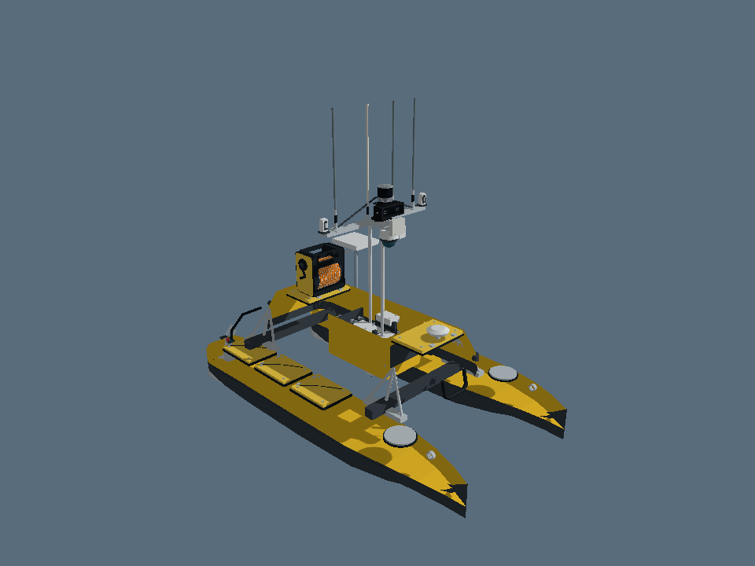

# USV–ROV 10k: site models transferred to ROS 2

This package reuses the current Recovery Studio geometry in ROS 2 URDF and Gazebo SDF formats. It is a **visual description release**, with a static Gazebo preview. It does not yet implement buoyancy, thrusters, collision response, tether physics, docking forces, sensor data, PTZ control or real hardware drivers.

Source: **Unmanned Research Lab — ROV Recovery Studio**, Site version 58, repository commit `9edda0a7a7fcd8700558ed00c44bbd2e29d9196e`. Exported 6 November 2026. The source website was not modified.



## Included models

| Model | Transferred content |
|---|---|
| `me120` | Hulls, bridge, cabin, lift/mount geometry, mast, original Hikvision housing, antenna geometry, procedural RoboSense and ZED housings, sensor bracket/cables, radar housing, mounted E-Reel, Starlink and support pole. |
| `m2_pro_max` | Body, battery, frame, camera, thrusters, lights and tether connector, including the current site's anatomy corrections. |
| `e_reel` | Separate CHASING E-Reel reference model. |
| `starlink_mini` | Separate conceptual panel and mount. |
| `compute_enclosure` | Conceptual enclosure supplied by the site. |
| `recovery_concept` | Capture head, ROV yoke and tether guide as separately identified static concept parts. |
| `showcase` | The six models placed side by side for visual inspection. These offsets are presentation positions, not deployment constraints. |

## Run in ROS 2 Jazzy

Use Ubuntu 24.04 with ROS 2 Jazzy installed. This public repository can be cloned without GitHub authentication. These commands run on your machine.

1. Clone the repository into your colcon workspace and build the package:

```bash
mkdir -p ~/usv_rov_ws/src
git clone https://github.com/AffanIman01/usv-rov-ros2.git ~/usv_rov_ws/src/usv-rov-ros2
cd ~/usv_rov_ws
source /opt/ros/jazzy/setup.bash
rosdep install --from-paths src/usv-rov-ros2/usv_rov_description --ignore-src -r -y
colcon build --symlink-install --packages-select usv_rov_description
source install/setup.bash
```

2. Open the complete visual collection in RViz:

```bash
ros2 launch usv_rov_description display.launch.py
```

3. Open one model:

```bash
ros2 launch usv_rov_description display.launch.py model:=me120
ros2 launch usv_rov_description display.launch.py model:=m2_pro_max
```

Run only one of these display launches at a time unless you deliberately configure separate ROS namespaces and frames. Every description uses `base_link` as its root.

4. Open the static Gazebo Harmonic preview:

```bash
ros2 launch usv_rov_description gazebo_preview.launch.py
```

If Gazebo/ROS integration is missing on an otherwise configured Jazzy machine, install `ros-jazzy-ros-gz` using your normal Ubuntu package workflow. The preview sets `GZ_SIM_RESOURCE_PATH` to the installed package's mesh and model locations.

## What the conversion preserves

- GLB geometry, component grouping and site assembly transforms.
- The site's 1.40 m hull-beam adjustment and neutral raised lift pose.
- The site's procedural sensor rack and updated ROV anatomy.
- Basic diffuse colors in COLLADA meshes, rather than colorless STL output.
- Proper rigid coordinate rotations with determinant +1, without mirroring.
- The source model's approximate geometry and explicitly provisional component identifications.

The GLB models use Y up and +Z bow. The exported ROS body convention is X forward, Y left, Z up, with `(x_ros,y_ros,z_ros)=(z_source,x_source,y_source)`. Recovery geometry defined in the site's scene frame uses `(x_ros,y_ros,z_ros)=(x_scene,-z_scene,y_scene)`. Units are metres.

## Limits to understand

**Geometry:** The site's models are photo-derived visual references, not OEM CAD. Sensor variants, installation dimensions and extrinsic calibration remain unconfirmed. The complete ROV envelope includes protruding lights and other geometry, so it is larger than the nominal body dimensions stated in the website.

**Appearance:** Website lighting, metallic/clearcoat rendering, animated propellers, light beams, water, HUD and small canvas wordmarks are not transferred. The mesh surfaces use simplified diffuse materials. `MODEL_PREVIEW.png` is a separate mesh inspection image. `runtime_evidence/ME120_GAZEBO_RENDER.png` is an actual Gazebo Ogre2 offscreen render of all 17 ME120 parts.

**Frames:** `zed_mount_frame`, `robosense_mount_frame` and `hikvision_mount_frame` are approximate visual reference points. They are not calibrated sensor origins or optical frames. The Hikvision frame comes from the site's inspection centre; its geometry remains part of the mast mesh. No pan/tilt joints or stereo optical transforms are invented.

**Side labels:** The source contains `hull_port` and `hull_starboard` identifiers whose semantic side labels conflict with its declared bow/up convention after a proper right-handed conversion. Original identifiers and geometry are retained for traceability. Confirm physical port/starboard and navigation-light placement before using those labels in control or perception.

**Recovery concept:** The current source still contains latch housings, positive-lock pins and keeper lugs. They remain visible as inherited concept geometry; they are not confirmation of a final magnetic-only design. Head/yoke origins are carrier-local while the tether guide is boat-local. The separate static model is a component reference, not a connected recovery mechanism.

**Physics:** URDF files contain fixed visual links, without guessed mass, inertia or collision shapes. SDF models are static. They cannot validate flotation, stability, current rejection, magnetic holding force or retrieval performance.

**Verification:** ROS 2 Jazzy and Gazebo Harmonic were installed in the test environment. The package built with colcon; all seven URDFs, 84 expected static transforms, seven SDF files and 39 native mesh imports passed. The complete ME120 also rendered with Gazebo Ogre2 using software EGL. Full Gazebo server stepping and the RViz window remain blocked by environment networking/display restrictions. See the repository root `VALIDATION.md` and `runtime_evidence/RUNTIME_TEST_REPORT.md` for exact scope, logs and installation limitations.

## Next implementation work

Confirm the sensor models and measured transforms, then add sensor plugins and ROS bridges. Physical simulation additionally needs verified masses, centres of gravity/buoyancy, inertias, simplified collision geometry, hydrodynamic coefficients, thruster models, tether properties and recovery constraints. Keep the visual meshes as the appearance layer while developing those models separately.

## Files and reproducibility

`usv_rov_description/` is the ROS package. `tools/validate_models.py` checks the exported files without ROS. `tools/export_source/` contains the conversion code and the bounded source snapshot used to produce these meshes. Run its exporter with a modern Node.js runtime:

```bash
cd tools/export_source
npm install --ignore-scripts --package-lock=false
node export_models.mjs source_dist ../../usv_rov_description
```

The npm step obtains the matching Three.js version; it is not needed to use the already exported ROS package. The regeneration command writes the model files and intermediate hidden geometry JSON alongside the ROS package. No website credentials or live-hardware connection details are included.

No new public software or asset license is granted by this transfer. Confirm project ownership and source/vendor terms before external redistribution.
