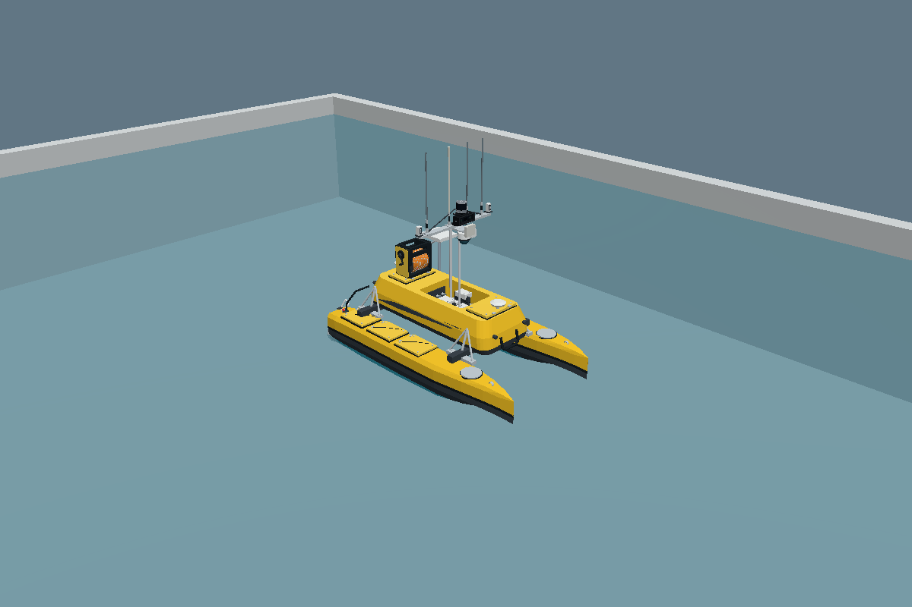
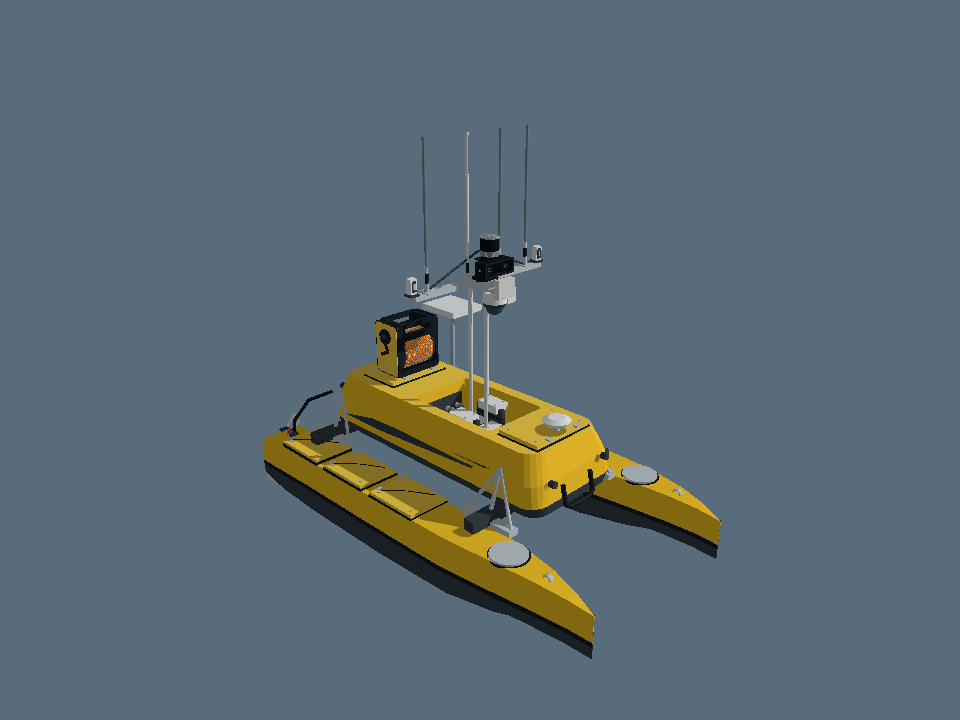

# USV–ROV 10k: ROS 2 models and marine simulation

This repository reuses the Recovery Studio geometry in ROS 2 URDF and Gazebo SDF formats. `usv_rov_description` preserves the visual models and static previews. `usv_rov_sim` adds an estimated calm-water ME120 simulation with buoyancy, water resistance, twin-thruster forces, smooth combined steering, a moving mast lift and navigation lights. The default is a **small 20 × 12 m offline pool** for initial VMware testing. VRX's Sydney Regatta world remains an optional larger environment. ROV dynamics, tether physics, docking, sensor data and hardware drivers are future work.

## Start with the small pool

Use Ubuntu 24.04 with ROS 2 Jazzy / Gazebo Harmonic. Stop the previous simulation with Ctrl+C in its launch terminal, then run these commands from your existing checkout:

```bash
git pull --ff-only
sudo apt install python3-tk
bash tools/run_sim.sh
```

The default pool has simple geometry and needs no terrain download. It uses the same ME120 model, buoyancy, drag and thruster controls. Start here before trying the larger environment.



In a second terminal, from the same checkout:

```bash
bash tools/run_sim.sh --keyboard
```

Keep the **ME120 control window** focused. It tracks each held key independently and ramps throttle/steering smoothly.

| Control | Action |
|---|---|
| W / S | Forward / reverse |
| A / D | Left / right steering |
| W+A / W+D | Keep moving while steering |
| U / J | Raise / lower the mast lift; release to hold position |
| Space | Cut drive thrust and hold the lift immediately |
| Q / Esc | Close the control window |

Releasing A/D while holding W smoothly straightens the turn without dropping forward throttle. Sliders set the speed and turn limits. Switching to another window stops commands; the boat still coasts under water resistance. The older terminal controller is available with `--keyboard-terminal`, but does not provide reliable simultaneous held keys or lift control. Run only one controller at a time.

The lift follows Studio version 60: the moving carrier, mast and sensor rack travel together from raised to **65% down (0.2717 m)**. Its position indicator uses measured joint feedback. The red port/left and green starboard/right navigation lenses stay illuminated and move with the mast; left/right are defined while looking toward the bow. The lift uses estimated actuator dynamics and does not deploy the ROV. See [implementation and validation](runtime_evidence/controls_lift_lights/REPORT.md).

**Buoyancy startup correction:** Gazebo configures a model's plugins before attaching it to the world. The earlier buoyancy plugin rejected that temporary state and stayed disabled. It now resolves the world on the first physics update. A regression test recreates the real startup event order and failed with the old code. The launcher also pins Gazebo 8, checks the custom plugin libraries and monitors flotation feedback. See [fix verification and remaining limits](runtime_evidence/sydney_startup_fix/REPORT.md).

**Wall-contact crash correction:** an almost level hull could trigger numerical overflow in the underwater-volume centroid calculation. The calculation now uses geometric clipping, with regression checks for near-level orientations and sustained wall contact. See [pool stability follow-up](runtime_evidence/pool_stability_followup/REPORT.md).

For VMware graphics trouble, try `bash tools/run_sim.sh --software`; this changes rendering only and is not a flotation fix. Both `tools/run_sim.sh` and `tools/run_pool.sh` now default to the pool. Each launch saves its own log under `.pool_ws/runs/` and updates `.pool_ws/last-launch.log`, preserving the preceding log before a restart.

If the boat sinks or feedback stops, the passive monitor reports its error and leaves Gazebo open for inspection. Actual Gazebo/bridge exits still stop the remaining processes, with the component name and exit code printed. `STALE` means odometry has stopped arriving; it does not establish why. To show the log without restarting, run:

```bash
bash tools/run_sim.sh --diagnose
```

Sydney Regatta is available with `bash tools/run_sim.sh --world sydney_regatta`. Its first run downloads and verifies 129 MB of existing OpenRobotics terrain. See [world sources and licenses](usv_rov_sim/worlds/SOURCES.md).

See [dependencies, diagnostics and controls](usv_rov_sim/README.md). To run an automatic headless movement check on your Ubuntu machine, stop the interactive simulation and run `bash tools/run_sim.sh --self-test`. It checks flotation, forward movement, turning, stopping, combined steering, lift travel/holding and command timeouts, and writes `.pool_ws/last-test.json` plus `.pool_ws/last-test.log`.

## Original model transfer

Source: **Unmanned Research Lab — ROV Recovery Studio**, Site version 58, repository commit `9edda0a7a7fcd8700558ed00c44bbd2e29d9196e`. Exported 6 November 2026. The source website was not modified.

**ME120 visibility correction (6 November 2026, MYT):** The website renders both sides of its USV surfaces. The ROS export now preserves that behavior, fixing the missing yellow cabin/deck surfaces in RViz and Gazebo. Model dimensions, component positions and all ROV assets are unchanged. The added reverse-facing surfaces are for rendering only. See the repository root `runtime_evidence/me120_visibility_fix/REPORT.md` for verification.



## Included models

| Model | Transferred content |
|---|---|
| `me120` | Hulls, bridge, cabin, lift/mount geometry, mast, original Hikvision housing, antenna geometry, procedural RoboSense and ZED housings, sensor bracket/cables, radar housing, mounted E-Reel, Starlink and support pole. |
| `m2_pro_max` | Body, battery, frame, camera, thrusters, lights and tether connector, including the current site's anatomy corrections. |
| `e_reel` | Separate CHASING E-Reel reference model. |
| `starlink_mini` | Separate conceptual panel and mount. |
| `compute_enclosure` | Conceptual enclosure supplied by the site. |
| `recovery_concept` | Capture head, ROV yoke and tether guide as separately identified static concept parts. |
| `showcase` | The six models placed side by side for visual inspection. These offsets are presentation positions, not deployment constraints. |

## Run in ROS 2 Jazzy

Use Ubuntu 24.04 with ROS 2 Jazzy installed. This public repository can be cloned without GitHub authentication. These commands run on your machine.

### Verified preview when an older model still appears

Stop the previous display launch with **Ctrl+C in its terminal**. Closing only the RViz window can leave the old robot-state publisher running.

From any checkout of this repository:

```bash
git pull --ff-only
bash tools/preview_model.sh me120
```

The helper builds a separate `.preview_ws` inside this checkout, selects that installation, compares the installed URDF and every referenced mesh with this source, then starts a fresh RViz process. It works regardless of the parent workspace name. It leaves the existing workspace intact. The console prints the selected package path and the cabin triangle count; the corrected cabin has **7,552 triangles**. Use `--check-only` to build and verify without opening RViz.

If the old checkout location is uncertain, use a new directory:

```bash
git clone https://github.com/AffanIman01/usv-rov-ros2.git ~/usvrov_rviz_fix
bash ~/usvrov_rviz_fix/tools/preview_model.sh me120
```

The November 6 RViz follow-up verified all 39 meshes with RViz's actual installed mesh-loading library, including reverse-facing cabin surfaces. This is an import test, not a test of the VMware RViz window. See [RViz import evidence](runtime_evidence/rviz_import_followup/REPORT.md). If surfaces are still absent after the helper reports matching files, include its printed package path and cabin count with the RViz screenshot so the remaining renderer-specific issue can be investigated.

### Standard colcon workspace

1. Clone the repository into your colcon workspace and build the package:

```bash
mkdir -p ~/usv_rov_ws/src
git clone https://github.com/AffanIman01/usv-rov-ros2.git ~/usv_rov_ws/src/usv-rov-ros2
cd ~/usv_rov_ws
source /opt/ros/jazzy/setup.bash
rosdep install --from-paths src/usv-rov-ros2/usv_rov_description --ignore-src -r -y
colcon build --symlink-install --packages-select usv_rov_description
source install/setup.bash
```

2. Open the complete visual collection in RViz:

```bash
ros2 launch usv_rov_description display.launch.py
```

3. Open one model:

```bash
ros2 launch usv_rov_description display.launch.py model:=me120
ros2 launch usv_rov_description display.launch.py model:=m2_pro_max
```

Run only one of these display launches at a time unless you deliberately configure separate ROS namespaces and frames. Every description uses `base_link` as its root.

4. Open the static Gazebo Harmonic preview:

```bash
ros2 launch usv_rov_description gazebo_preview.launch.py
```

If Gazebo/ROS integration is missing on an otherwise configured Jazzy machine, install `ros-jazzy-ros-gz` using your normal Ubuntu package workflow. The preview sets `GZ_SIM_RESOURCE_PATH` to the installed package's mesh and model locations.

## What the conversion preserves

- GLB geometry, component grouping and site assembly transforms.
- The site's 1.40 m hull-beam adjustment and neutral raised lift pose.
- The site's procedural sensor rack and updated ROV anatomy.
- Basic diffuse colors in COLLADA meshes, rather than colorless STL output.
- Proper rigid coordinate rotations with determinant +1, without mirroring.
- The source model's approximate geometry and explicitly provisional component identifications.

The GLB models use Y up and +Z bow. The exported ROS body convention is X forward, Y left, Z up, with `(x_ros,y_ros,z_ros)=(z_source,x_source,y_source)`. Recovery geometry defined in the site's scene frame uses `(x_ros,y_ros,z_ros)=(x_scene,-z_scene,y_scene)`. Units are metres.

## Limits to understand

**Geometry:** The site's models are photo-derived visual references, not OEM CAD. Sensor variants, installation dimensions and extrinsic calibration remain unconfirmed. The complete ROV envelope includes protruding lights and other geometry, so it is larger than the nominal body dimensions stated in the website.

**Appearance:** Website lighting, metallic/clearcoat rendering, animated propellers, light beams, water, HUD and small canvas wordmarks are not transferred. The mesh surfaces use simplified diffuse materials. `MODEL_PREVIEW.png` is a separate mesh inspection image. `runtime_evidence/me120_visibility_fix/ME120_FRONT.png` is the corrected Gazebo Ogre2 render; the original render is retained in the baseline evidence.

**Frames:** `zed_mount_frame`, `robosense_mount_frame` and `hikvision_mount_frame` are approximate visual reference points. They are not calibrated sensor origins or optical frames. The Hikvision frame comes from the site's inspection centre; its geometry remains part of the mast mesh. No pan/tilt joints or stereo optical transforms are invented.

**Side labels:** The source contains `hull_port` and `hull_starboard` identifiers whose semantic side labels conflict with its declared bow/up convention after a proper right-handed conversion. Original identifiers and geometry are retained for traceability. The dynamic simulation assigns its new navigation lenses by physical ROS coordinates: +Y port is red, −Y starboard is green. The inherited hull identifiers should not be used to infer those sides.

**Recovery concept:** The current source still contains latch housings, positive-lock pins and keeper lugs. They remain visible as inherited concept geometry; they are not confirmation of a final magnetic-only design. Head/yoke origins are carrier-local while the tether guide is boat-local. The separate static model is a component reference, not a connected recovery mechanism.

**Physics:** The original `usv_rov_description` URDFs and SDFs remain visual-only/static. The separate `usv_rov_sim` package adds estimated ME120 calm-water dynamics. These estimates are useful for software prototyping but do not validate real-vessel stability, current rejection, magnetic holding force or retrieval performance.

**Verification:** ROS 2 Jazzy and Gazebo Harmonic were installed in the test environment. The package built with colcon; all seven URDFs, 84 expected static transforms, seven SDF files and 39 native mesh imports passed. The complete ME120 also rendered with Gazebo Ogre2 using software EGL. Full Gazebo server stepping and the RViz window remain blocked by environment networking/display restrictions. See the repository root `VALIDATION.md` and `runtime_evidence/me120_visibility_fix/REPORT.md` for the latest correction. `runtime_evidence/RUNTIME_TEST_REPORT.md` records the initial baseline and its environment limitations.

## Next implementation work

Next stages are ROV motion/depth control, simulated sensors, then deployment and recovery. Confirm sensor models and measured transforms before adding their sensor configurations. Calibrate the pool prototype using measured mass, centre of gravity, inertia, displacement, damping and thrust data. Tether properties and recovery constraints remain separate work. Keep the visual meshes as the appearance layer while developing these models separately.

## Files and reproducibility

`usv_rov_description/` is the ROS package. `tools/validate_models.py` checks the exported files without ROS. `tools/export_source/` contains the conversion code and the bounded source snapshot used to produce these meshes. Run its exporter with a modern Node.js runtime:

```bash
cd tools/export_source
npm install --ignore-scripts --package-lock=false
node export_models.mjs source_dist ../../usv_rov_description
```

The npm step obtains the matching Three.js version; it is not needed to use the already exported ROS package. The regeneration command writes the model files and intermediate hidden geometry JSON alongside the ROS package. No website credentials or live-hardware connection details are included.

No new public software or asset license is granted by this transfer. Confirm project ownership and source/vendor terms before external redistribution.
