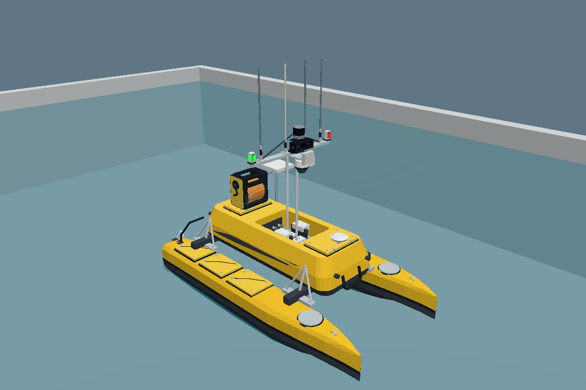
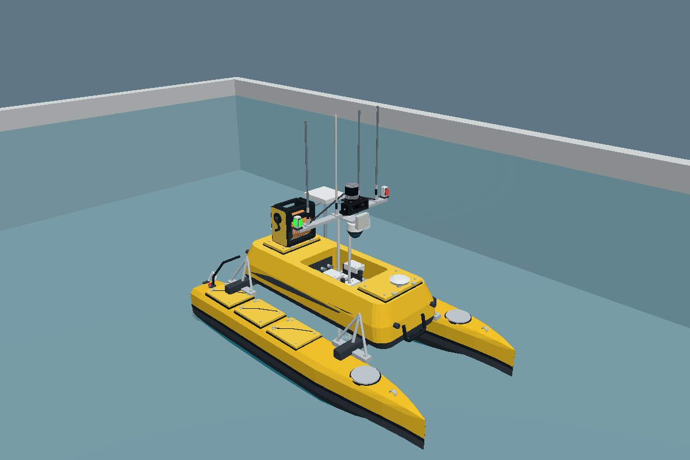
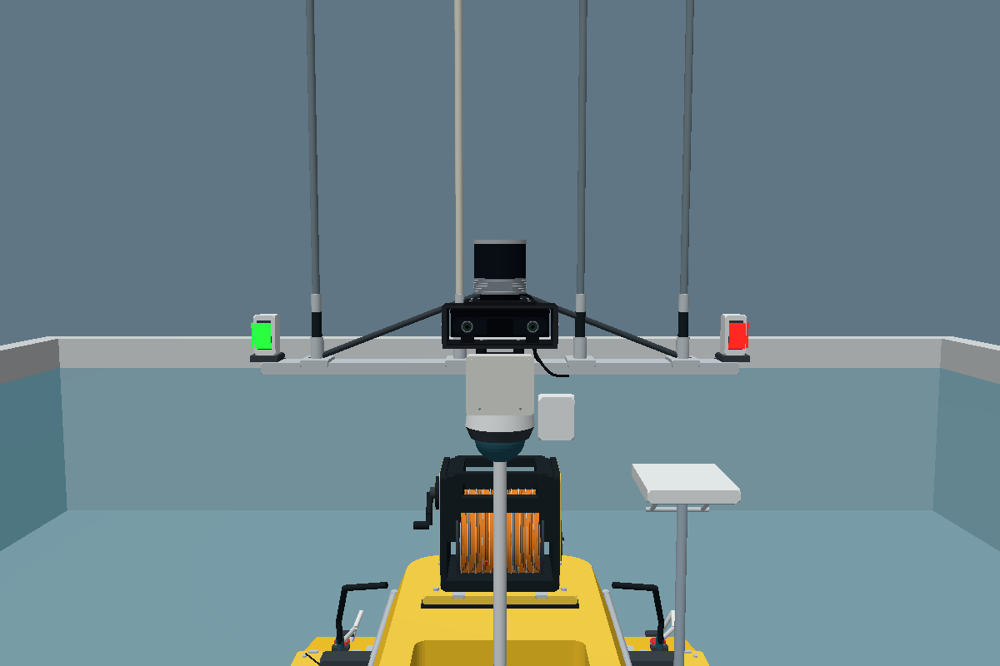

# Smooth controls, mast lift and navigation lights

Implemented 6 November 2026 on the working pool-stability baseline `b9273c69d36263a03879b941ec55dc91e6e4b218`.

## Behavior

The new `tools/run_sim.sh --keyboard` command opens a focused control window. W/S and A/D are independent held keys, so W+A/W+D combine forward motion and steering. Each axis ramps its command, and releasing steering preserves forward input. U raises the mast lift; J lowers it; releasing U/J holds the measured joint position. Space immediately sends zero drive and lift-hold commands. Closing the window, focus loss and a control timer interruption also stop commands. The vessel slows physically under drag.

The window shows commanded and measured motion, ROS subscriber counts and actual lift position. Speed/yaw limits are adjustable. Keyboard auto-repeat release/press pairs are filtered. Space and timer interruptions block previously held keys until release. After focus leaves the window, held state is cleared; a new OS key event on returning can resume control, including auto-repeat from a physically held key.

The previous terminal controller remains available as `--keyboard-terminal`. It has no reliable simultaneous key tracking or lift controls. Only one controller should run at a time. Install `python3-tk` once for the new window.

## Studio reference and model

Reference: Recovery Studio version 60, source commit `893cd2a47913549e87ab3442d583f918d8934e36`. `dist/lift.mjs` defines a 0.418 m reference stroke and a 65% lower stop. The dynamic model therefore has a real prismatic joint with downward travel 0..0.2717 m. The eight moving meshes are the carrier, mounting ring, antenna/mast, sensor bracket, ZED housing, RoboSense housing, front cover and service loops.

The actuator applies joint force with gravity compensation and PD feedback; it does not set vessel pose, reset joint position or lock the boat to the surface. Its target speed is limited to 0.1045 m/s (the Studio animation rate), acceleration to 0.25 m/s² and effort to 150 N. A zero command or a 0.4 s wall-time expiry captures a hold position. A moving mass of 5 kg is provisional. The 115 kg base is compensated so the raised aggregate remains 120 kg, COM z=0.1 m and diagonal inertia 35/70/90 kg·m². These properties are estimates, not measured ME120 performance.

Four small always-on emissive panels cover the forward/outboard lens faces of the two existing white navigation-light housings. Port/left is red at ROS +Y and starboard/right is green at ROS −Y, viewed facing forward (+X). The panels travel with the mast. No original meshes or ROV assets changed. The lights illustrate appearance and placement, without photometric/visibility-sector modeling. Static RViz previews remain fixed; lift operation is in the dynamic Gazebo model.

## Verification

| Check | Result |
|---|---|
| Colcon build and all three custom system libraries | Passed |
| CTest suites | 10/10 passed, including 16 control-window state/callback tests |
| Raised mass, CG, inertia and original visual poses | Preserved; see `model-invariants.json` |
| Native Gazebo/DART expectations | 20/20, including 17 production cases and 3 upstream negative controls |
| Complete lower/hold/raise cycle | 0..0.2717 m, peak lift speed 0.1045 m/s |
| Static hold after lowering | 1.48 µm late hold error in this deterministic model |
| Lift command timeout away from stops | Held near 0.123754 m; 1.46 µm late hold error |
| Repeated lift cycles while turning | 60 s passed; hull z 0.152636..0.152962 m |
| Driving with lift lowered | 30 s passed, including pool-wall contact |
| Sustained wall contact / mixed commands | 180 s each passed |
| Actual Ogre2 visual rendering | Raised, lowered and lamp-detail images passed |
| Complete ROS bridge/server test | Blocked by host networking; failed rather than reporting a pass |
| Live Tk window / VMware desktop | Not verified; Xvfb could not create local sockets |

The native harness advances the installed DART Physics system, uses the production SurfaceBuoyancy shared library with real startup event ordering, and applies the production thrust/lift controller cores. It reads actual joint position/velocity. The configured diagonal drag equation is applied by the harness because Hydrodynamics transport cannot initialize here. Native results do not establish live ROS transport, plugin subscriber behavior, actual GUI key events or VMware graphics behavior. The micrometre holding figures describe a deterministic numerical test, not physical actuator accuracy.

The live bridge attempt was run with the updated model and script. The host reports `getifaddrs: Operation not permitted`, and Gazebo/bridge exit before usable feedback. `bridge-result.json` records failure; a coordinated launch exit code of zero is not counted as success. Standard Xvfb/Tk validation also failed to create its display sockets. No networking/security restrictions were changed or bypassed.

## Evidence and reproduction

- `build-check.log`, `unit-tests.log`, `model-invariants.json`
- `native/results.json` and per-case logs, including source hashes
- `render/results.json`, `render/raised.png`, `render/lowered.png`, `render/navigation-lights.png`
- `bridge-result.json`, `bridge-attempt.log`, `full-launch.log`
- `tk-server.log`, `tk-client.log`

Native commands are documented in `tools/runtime/marine/README.md`; image generation commands are in `tools/runtime/pool_render/README.md`. On Ubuntu 24.04 / Jazzy, stop the interactive launch then run `bash tools/run_sim.sh --self-test` for the complete ROS/Gazebo check. It now requires fresh joint-position feedback and tests lift travel/holding/expiry and combined steering as well as flotation and propulsion.

