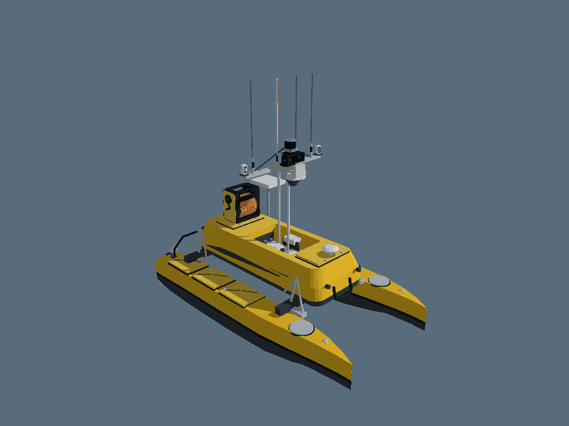
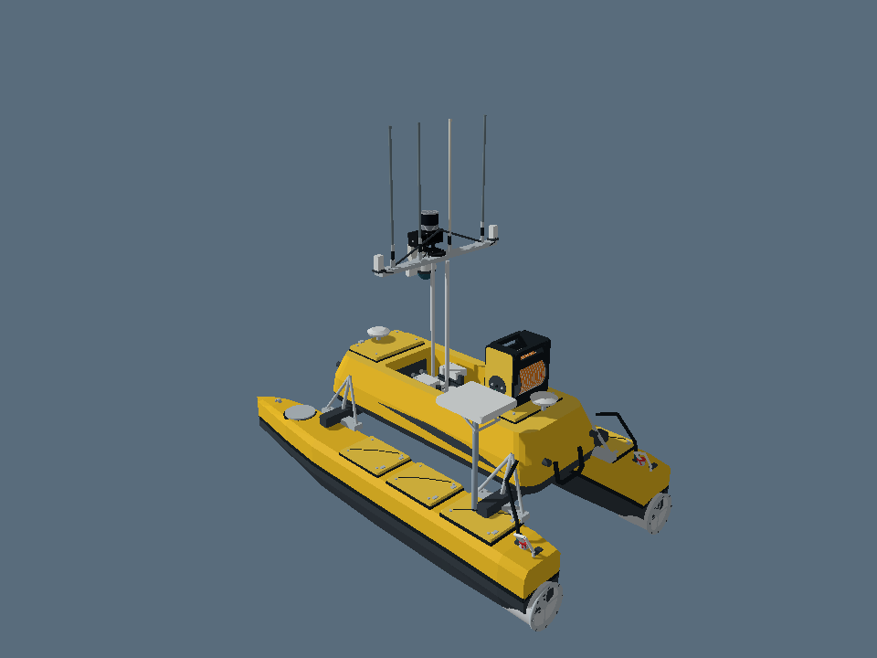

# ME120 surface visibility correction

Verified 5 November 2026 UTC / 6 November 2026 MYT, against repository baseline `549eb948fdfca41f038ca23bd95020fc2a84a621`.

The user reported missing yellow cabin and deck surfaces in RViz on Ubuntu 24 under VMware. The website's ME120 GLB uses double-sided materials, including surfaces with inward triangle winding. The previous COLLADA exporter discarded the material side setting. One-sided rendering consequently hid those surfaces when viewed from outside.

The exporter now preserves double-sided appearance for ME120 materials by emitting reverse-facing triangles with separate, reversed normals. This avoids relying on importer-specific COLLADA material flags. It does not reshape, reposition or rescale any components. Only ME120 mesh assets change; all ROV assets remain byte-identical to the baseline. See [ROV file hashes](rov-unchanged.json).

## Actual Gazebo rendering

These images were captured with Gazebo Rendering's native Ogre2 backend, using headless EGL software rendering. All 17 ME120 parts are placed at their manifest offsets. They are renderer captures, not Gazebo GUI or RViz screenshots.





Both views show the complete yellow cabin shell, rounded end caps and top rim. The upper opening is part of the website geometry and is retained. Lighting and simplified diffuse materials differ from the website's renderer.

## Checks run on this revision

| Check | Result |
|---|---|
| Structural validation | Passed: 39 DAE meshes, 7 URDFs and 7 SDFs. |
| Colcon build and install | Passed for `usv_rov_description`. |
| Native Gazebo mesh import | Passed for all 39 meshes; per-mesh triangle counts and bounds agree with exported data within 1 micrometre. |
| Rendered ME120 assembly | Passed: front and rear views, 17 parts. |
| ROV preservation | All tracked ROV meshes, URDF and SDF resources match the baseline byte for byte. |

ME120 has 121,908 render triangles; the whole collection has 182,316. The increase consists of reverse-facing visual surfaces. The ME120 bounds remain approximately 2.549 × 1.400 × 2.297 m, including antennas and mounted equipment. The additional faces are not collision geometry and must not be used to infer volume or inertia.

The native mesh checker now derives its expected total from the generated per-mesh expectations rather than a hardcoded total. Per-mesh count, material and bounds checks remain in place. The checked-in checker source was compiled and executed for this verification.

Machine-readable results are in [results.json](results.json), structural checks in [structural-validation.json](structural-validation.json), and build/import/render output in [logs](logs/).

## Reproduce the two views

From the repository root, after sourcing ROS 2 Jazzy and installing the Gazebo rendering development dependencies described in `tools/headless_render/README.md`:

```bash
source /opt/ros/jazzy/setup.bash
python3 tools/headless_render/make_parts.py usv_rov_description /tmp/me120-parts.tsv
cmake -S tools/headless_render -B /tmp/usv-render-build
cmake --build /tmp/usv-render-build -j2
LIBGL_ALWAYS_SOFTWARE=1 EGL_PLATFORM=surfaceless GZ_IP=127.0.0.1 \
  /tmp/usv-render-build/headless_probe /tmp/me120-parts.tsv /tmp/me120-front.png
LIBGL_ALWAYS_SOFTWARE=1 EGL_PLATFORM=surfaceless GZ_IP=127.0.0.1 \
  /tmp/usv-render-build/headless_probe /tmp/me120-parts.tsv /tmp/me120-rear.png rear
```

`tools/headless_render/probe.cpp` contains both camera poses used for these images. The native importer can be reproduced with `tools/runtime/build_mesh_expectations.py` and `tools/runtime/native/check_gazebo_meshes.cpp`, as described in `tools/runtime/TEST_PLAN.md`.

RViz GUI, full Gazebo simulation stepping, physics, sensors and hardware integration were not tested for this correction. Previous environment restrictions and the initial static-transform tests remain documented in [the historical runtime report](../RUNTIME_TEST_REPORT.md). This correction addresses visual mesh visibility; the package remains a static visual description.

## Update an existing Ubuntu 24 / ROS 2 Jazzy workspace

Close the current RViz process first. For a checkout at `~/usvrov/src/usv-rov-ros2`:

```bash
cd ~/usvrov/src/usv-rov-ros2
git pull --ff-only
cd ~/usvrov
source /opt/ros/jazzy/setup.bash
colcon build --symlink-install --packages-select usv_rov_description
source install/setup.bash
ros2 launch usv_rov_description display.launch.py model:=me120
```

Adjust the checkout path if it differs. No ROS reinstall or VMware setting change is required for this material export correction.
