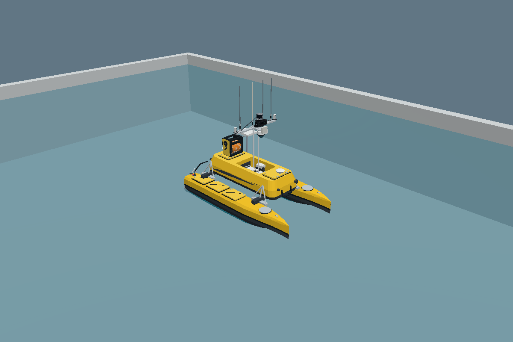

# ME120 calm-water simulation verification

6 November 2026, Asia/Kuala_Lumpur. Initial model repository baseline: `33577a7f00b77692281847782ceda6ce21ef6901`.

This stage adds a dynamic USV pool model, a physical twin-thruster controller, a ROS/Gazebo bridge and momentary terminal keyboard controls. All original USV and ROV visual assets remain unchanged. The mass, inertia, displacement proxies, damping and thruster limits are explicitly provisional simulation values, not measured ME120 calibration.

## Results in the local test environment

| Check | Result |
|---|---|
| Colcon build/install | Both packages built; installed visual hashes match the source. |
| Native plugin loading | Gazebo discovers both `SurfaceBuoyancy` and `TwinThrusterController` and their interfaces. |
| CTest | Controller, buoyancy geometry and keyboard input suites passed. |
| SDF validation | Dynamic model and complete pool world passed. |
| Native physics | 11 production checks and 3 baseline-control expectations passed. |
| Native rendering | Both initial pool views rendered with Gazebo Ogre2/EGL; 23 visuals including all 17 USV meshes. |
| Complete ROS/Gazebo launch | Blocked by this host's `getifaddrs: Operation not permitted` restriction. Child server and bridge exited 255. The parent launch exited 0 after shutdown; that is **not** a successful integration test. |
| GitHub-hosted integration check | Attempted, but the job failed before a runner was assigned or any test step executed. This is **not** an integration pass. [Run details](github-ci.json). |
| VMware GUI | Not directly tested here. |

The native physics harness runs the actual Gazebo/DART Physics system and the actual installed `SurfaceBuoyancy` shared library. It applies the production controller's force calculation. Because the built-in Hydrodynamics system initializes transport, this host cannot instantiate it; the harness applies the configured diagonal drag equation directly. These checks do not substitute for the complete live ROS-to-Gazebo command path. The repository includes a separate manual GitHub Actions integration check for the actual server, Hydrodynamics, controller and bridge. Its attempted hosted run did not execute any steps, so live command delivery remains unverified. The same check can run on the user's Ubuntu machine using `tools/runtime/marine/ros_bridge_smoke.py`.

## Measured native simulation behaviour

| Scenario | Measurement |
|---|---|
| Unforced float, 60 simulated seconds | Final body-origin z ≈ 0.152785 m. |
| Roll disturbance, 0.08 rad | Returns to approximately level. |
| Pitch disturbance, 0.08 rad | Returns to approximately level. |
| Heave disturbance, +0.1 m | Returns to the equilibrium waterline. |
| Forward target 0.8 m/s, 15 seconds | Travels 8.003 m; final forward velocity ≈ 0.559 m/s. |
| Reverse target −0.6 m/s, 15 seconds | Travels −6.139 m; final velocity ≈ −0.429 m/s. |
| Left/right turns | Opposite yaw-rate signs, approximately ±0.188 rad/s. |
| Thrust cut, 20 seconds of coasting | Speed decreases from 0.559 to 0.0011 m/s. |

Targets differ from achieved speed because this controller is proportional velocity feedback against drag with limited thrust. It is not a calibrated speed controller for the real vessel. Native checks and input hashes are in [native/results.json](native/results.json).

## Buoyancy correction discovered during testing

The installed Harmonic graded Buoyancy system produced a destabilizing +11.82 N·m pitch moment for a +0.05 rad pitch perturbation of this model. A +0.08 rad disturbance capsized it even without thrust. This agrees with the upstream [rotated-collision buoyancy defect](https://github.com/gazebosim/gz-sim/issues/3892).

The project `SurfaceBuoyancy` plugin rotates the fluid interface into each box's local frame before calculating submerged volume and its centroid using Gazebo Math. It applies air displacement plus the additional submerged water force at the corresponding centroids. In the same native test it produces a restoring −231.82 N·m pitch moment and stable recovery. Roll/pitch remain free physical degrees of freedom; they are not locked or overwritten. The world no longer enables the built-in buoyancy system, avoiding duplicate forces.

## Reproduce and inspect

- [Package setup and controls](../../usv_rov_sim/README.md)
- [Native physics harness](../../tools/runtime/marine/README.md)
- [Rendering probe](../../tools/runtime/pool_render/README.md)
- [Build log](build.log), [unit tests](unit-tests.log), [local full-launch log](full-launch.log)
- [Native test results](native/results.json), [render results](render/results.json)

This image verifies initial geometry and materials; it is not a video of dynamics or a screenshot of a running VMware GUI. ROV dynamics, sensor output, docking, tether forces and hardware control are outside this first stage.
