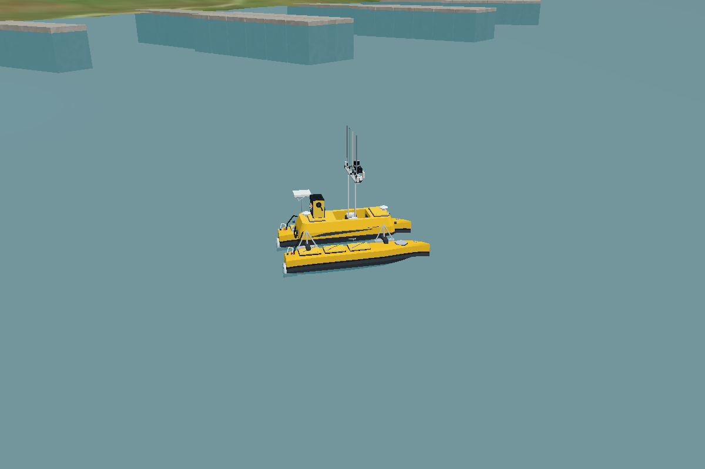

# Sydney Regatta and ME120 startup correction

**Later follow-up:** the default is now the small pool. A second numerical buoyancy defect was reproduced during sustained wall contact and corrected; see [pool stability and crash follow-up](../pool_stability_followup/REPORT.md) for current tests and launch behavior.

6 November 2026. Previous public baseline: `220cba88e668a6f4a8c7077b9cb01984a715cdaf`. Ubuntu 24.04, ROS 2 Jazzy, Gazebo Sim 8.15.0.

## Confirmed cause and correction

The user's report of sinking exposed a real startup defect. Gazebo's `SdfEntityCreator` emits the model `LoadSdfPlugins` event before setting the model's world parent. The old `SurfaceBuoyancy::Configure` required that parent immediately, logged an invalid-world error and permanently disabled buoyancy. The visual model still appeared and gravity still acted on it.

The plugin now resolves its world ancestor in the first `PreUpdate`, after entity creation is complete. Its displacement calculation and estimated vessel properties are unchanged. The identical lifecycle regression fails against the old committed plugin and passes against the fixed library, producing 1,177.2 N upward at the initial pose, balancing 120 kg × 9.81 m/s². See [before](lifecycle-before.log) and [after](lifecycle-after.log).

The native physics harness previously called Configure after the whole world existed. It now subscribes to the same startup event as Gazebo and requires that configuration happened before world-parent attachment. This closes the gap that allowed the earlier test to pass.

## Physics comparison

The corrected harness reproduced both reported symptoms with the old plugin: the boat sank to the pool floor and contact friction stalled forward motion. The fixed plugin floated and moved under the same force calculation.

| Measurement | Old plugin | Corrected plugin |
| --- | ---: | ---: |
| Body-origin height after 60 seconds idle | −1.750 m, pool floor | +0.152784 m, floating |
| Forward displacement after 15 seconds, target 0.8 m/s | 0.891 m before settling on floor | 8.003 m |
| Final forward velocity | Approximately zero | 0.559 m/s |

All 14 native expectations passed: equilibrium, roll/pitch/heave recovery, forward/reverse movement, turning, coast-down and restoring moments, plus three expected-failure controls for the installed built-in buoyancy implementation. Results and input hashes: [current native results](native/results.json), [old-plugin comparison](native/old_startup_results.json).

These checks execute the real installed DART Physics system and project buoyancy library. They apply the production thrust calculation and configured drag equation directly. They do **not** execute ROS transport, the controller's transport callback, or the built-in Hydrodynamics plugin. The complete command path must be assessed separately.

## Environment and launch

The default is now a calm-water adaptation of VRX's existing Sydney Regatta world. OpenRobotics Fuel terrain version 3 supplies the actual terrain, buildings, docks and shore collision mesh. Its 129 MB archive was downloaded, its SHA-256 verified, and all 17 extracted resources verified. The unchanged terrain is cached locally; it is not redistributed in this repository. [Sources, modifications and licenses](../../usv_rov_sim/worlds/SOURCES.md).

The launcher pins Gazebo 8, verifies both installed custom plugin classes, selects the matching world clock bridge and starts a passive flotation/feedback monitor. The keyboard reports command targets, subscriber presence and measured velocity. These indicators do not claim that a thruster command was acknowledged. The height monitor compares against its first odometry sample, so it cannot prove absolute water level if feedback starts after a boat has already settled underwater.

| Verification | Result |
| --- | --- |
| Colcon build and installed visual checks | Pass; 17 ME120 meshes and URDF match source. |
| CTest | All seven suites pass, including real startup ordering and missing-plugin rejection. [Log](unit-tests.log). |
| Installed plugin lookup | Both buoyancy and thruster classes load using the production filenames. |
| Native DART physics with corrected startup sequence | 14 expectations pass; old plugin reproduces sinking and floor stall. |
| Sydney terrain acquisition | Actual download and offline checksum verification pass. Corruption, symlink and traversal negative checks reject invalid data. |
| Sydney SDF | `gz sdf -k` passes with cached terrain and model paths. |
| Native Ogre2 rendering | 26 visuals render at initial poses, including the real Sydney asset and all 17 ME120 parts. |
| Full headless Sydney launch | Plugin preflight passes; server and bridge then exit 255 because this host blocks network discovery (`getifaddrs: Operation not permitted`). This is **not** an integration pass. [Log](full-launch.log), [result](full-launch-result.json). |
| VMware GUI and live keyboard-to-thrust delivery | Not tested from this environment. |

The full launch parent returned zero after shutting down failed child processes; that status is not used as test success. A user-machine integration check is provided as `bash tools/run_sim.sh --self-test`. It starts an isolated headless simulation, sends ROS velocity targets and measures flotation, forward movement, turning, stopping and command timeout. Results go to `.pool_ws/last-test.json` and `.pool_ws/last-test.log`.

This is a native static offscreen render, not a screenshot of the user's VMware window and not evidence of live dynamics. All original ROV assets remain unchanged. Waves, tether forces, docking and actual sensor drivers are not part of this correction.
